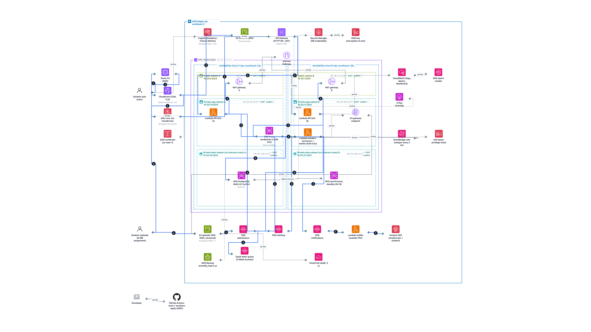

# DSO303 Assignment 2: Online Exams & Assignment Submission Platform

A highly available AWS platform for a university of 8,000 students and 400 staff to sit timed exams and submit
assignments online. Students sit timed MCQ + short-answer exams with **30-second autosave** and upload PDF/ZIP
assignments up to **50 MB**. Tutors create exams, mark and release results. Administrators manage users and schedules.
MCQs are auto-marked and emails go out asynchronously.

Everything is defined in **Terraform**, and a **push to `main` redeploys automatically** through GitHub Actions.



| Target | How |
|---|---|
| 300–500 normal users, **3,000 exam starts in 5 min** | CloudFront edge cache, API Gateway + Lambda per-request scaling, RDS Proxy connection pooling, SQS buffering of marking and email |
| **99.9%** during exams, **survives loss of one AZ** | Every tier in 2 AZs, NAT gateway per AZ, RDS Multi-AZ automatic failover, answers buffered in the browser |
| **RPO ≤ 5 min / RTO ≤ 1 h** | Synchronous standby (no loss on AZ failure), point-in-time restore from 5-minute transaction logs, automatic failover in 1–2 min |
| **Records kept 5 years** | S3 lifecycle (IA → Glacier IR → Deep Archive → delete at 1,830 d), AWS Backup monthly snapshots kept 1,830 d, CloudTrail 5 y |
| **Encryption in transit and at rest** | TLS everywhere (CloudFront, API, `rds.force_ssl`, proxy `require_tls`, S3 deny non-TLS); KMS key for RDS, secrets, uploads, backups |

## Deliverables

| Brief | Location |
|---|---|
| README: summary, deploy and tear-down | this file |
| Task 1: architecture diagram | [architecture/architecture.png](architecture/architecture.png) |
| Task 1: two request walkthroughs | [architecture/walkthroughs.md](architecture/walkthroughs.md) |
| Task 1: exam peak + AZ loss (≤ 300 words) | [architecture/peak-and-az-resilience.md](architecture/peak-and-az-resilience.md) |
| Task 2: service table | [docs/services.md](docs/services.md) |
| Task 3: Cloud Architecture Lab build | [architecture/cloud-lab-walkthrough-1-exam-autosave.json](architecture/cloud-lab-walkthrough-1-exam-autosave.json), [architecture/cloud-lab-walkthrough-2-upload-notify.json](architecture/cloud-lab-walkthrough-2-upload-notify.json) |
| Task 3: Cloud Architecture Lab evidence | [Evidence → Cloud Architecture Lab](#cloud-architecture-lab-task-3) |
| AWS deployment, IaC and CI/CD | [infra/](infra/), [backend/](backend/), [frontend/](frontend/), [.github/workflows/deploy.yml](.github/workflows/deploy.yml), [Evidence → AWS deployment](#aws-deployment) |

```
architecture/          diagram, walkthroughs, peak/AZ explanation, Cloud Architecture Lab files
docs/services.md       service table
evidence/              Cloud Architecture Lab and AWS deployment screenshots
infra/                 Terraform (infra/bootstrap: one-time state bucket + GitHub OIDC role)
backend/               Lambda code (API, submission processor, marker, notifier, migrate) + tests
frontend/              single-page app (HTML/JS/CSS, no build step)
scripts/               build, deploy-frontend, migrate, smoke-test, create-demo-users, integration-test
.github/workflows/     CI/CD pipeline
```

## Evidence

| Rubric criterion | Evidence |
|---|---|
| AWS architecture design | [Diagram](architecture/architecture.png), [walkthroughs](architecture/walkthroughs.md), [peak + AZ loss](architecture/peak-and-az-resilience.md). Both flows and the AZ loss behave as described in the lab (`cal-01`–`cal-03`) and on AWS (`aws-02`–`aws-04`). |
| AWS service documentation | [docs/services.md](docs/services.md) |
| Implementation – Cloud Architecture Lab | `cloud-architecture-lab`, `cal-01`, `cal-02`, `cal-03` |
| Implementation – AWS deployment | `aws-02` (frontend + API + database write), `aws-03` (frontend, API, two-AZ database), `aws-04` (S3 upload + async step) |
| Implementation – IaC and CI/CD | `aws-01` (push to `main` → tests → `terraform apply` → deploy), [infra/](infra/), [deploy.yml](.github/workflows/deploy.yml) |

### Cloud Architecture Lab (Task 3)

| Screenshot | What it proves |
|---|---|
| [cloud-architecture-lab](evidence/cloud-architecture-lab.png) | Full build: Region, VPC `10.20.0.0/16`, two AZs each with a public, a private-app and a private-data subnet, and every service in the design. |
| [cal-01-walkthrough1-exam-autosave](evidence/cal-01-walkthrough1-exam-autosave.png) | Walkthrough 1: Student → Route 53 → CloudFront → WAF → API Gateway → Lambda API (AZ-A) → RDS Proxy → RDS Multi-AZ writer. **HTTP 200 in 160 ms** over 15 steps. |
| [cal-02-walkthrough2-upload-notify](evidence/cal-02-walkthrough2-upload-notify.png) | Walkthrough 2: Student → S3 uploads → `sqs: send` to SQS submissions → Lambda event source mapping → the workers process and delete the message. **HTTP 202 in 40 ms**. |
| [cal-03-az-a-outage](evidence/cal-03-az-a-outage.png) | AZ failure: Failure Lab "AZ-A outage" fails the AZ-A resources, API Gateway routes to **Lambda API (AZ-B)**, and walkthrough 1 still returns **HTTP 200**. |

### AWS deployment

Deployed by the pipeline to `ap-southeast-2` on 17 November 2026 (UTC). The stack was destroyed and the workflow
disabled once the evidence was captured, to stop charges.

| Screenshot | What it proves |
|---|---|
| [aws-01-pipeline-push-deploy](evidence/aws-01-pipeline-push-deploy.png) | **CI/CD:** run `44181547081` was *triggered via push* to `main`. Unit + integration tests and Terraform validate ✓ (22 s), then Deploy to AWS ✓ (1 m 49 s): `terraform apply`, SPA upload + CloudFront invalidation, database migration and smoke test. No manual steps. |
| [aws-02-exam-autosave](evidence/aws-02-exam-autosave.png) | **Frontend + API + database write:** a student signed in through Cognito on the CloudFront URL, opened the exam with the server-side timer running, and autosave confirmed *"All answers saved 3:50:11 AM"*. |
| [aws-03-frontend-api-multi-az-db](evidence/aws-03-frontend-api-multi-az-db.png) | **Frontend:** CloudFront serves `UniExams – Online Exams & Submissions`. **API → Lambda → database:** `/api/health` returns `"db": "ok"`, answered in 2.1 ms by `10.20.20.190`, an address in private data subnet A (`10.20.20.0/24`). **Two-AZ database:** RDS `available`, `MultiAZ True`, primary `ap-southeast-2a`, standby `ap-southeast-2b`. |
| [aws-04-upload-async-processing](evidence/aws-04-upload-async-processing.png) | **S3 upload:** the 40 MB file (41,943,049 bytes) stored under `submissions/<assignment>/<student>/`. **Async step:** the processor Lambda logged `RECEIVED` at 21:53:03Z (S3 → SQS → Lambda), then the notifier sent *"New submission"* to the tutor and *"Submission receipt"* to the student at 21:53:26Z (SQS → Lambda → SES). |

**Deployment notes.** The demo account is on the AWS Free plan, which blocks RDS Proxy, RDS instances larger than micro
and backup retention over 1 day (Multi-AZ is allowed). The pipeline therefore deployed with `ENABLE_RDS_PROXY=false`,
`DB_INSTANCE_CLASS=db.t4g.micro` and `DB_BACKUP_RETENTION_DAYS=1`. Lambda connected straight to the Multi-AZ endpoint over TLS,
verified with the RDS CA bundle. The design, the lab model and the Terraform defaults keep RDS Proxy for production.

## Cloud Architecture Lab

Both files contain the same full architecture (2 AZs, public / private-app / private-data subnets, every service).
They differ only in where the simulated request starts: the lab reads the start point from the file, so each
walkthrough has its own file.

1. Open the lab → **Export** → **Upload JSON** → choose the file → **OK** to replace the workspace → **Fit View**.
2. **Send Request**:
   - `cloud-lab-walkthrough-1-exam-autosave.json`: Student → Route 53 → CloudFront → WAF → API Gateway → Lambda (AZ-A) → RDS Proxy → RDS Multi-AZ → **HTTP 200**.
   - `cloud-lab-walkthrough-2-upload-notify.json`: Student → S3 uploads (presigned POST) → SQS submissions → Lambda workers process it → **HTTP 202**.
3. **Failure Lab** → **Simulate AZ-A Outage** → **Send Request** again. The AZ-A Lambda and NAT gateway fail, API Gateway
   routes to the Lambda in AZ-B, and both walkthroughs still succeed.
4. Screenshots are in [evidence/](evidence/). The architecture diagram is the lab's **Download PNG** export of this design.

## Deploy

### Prerequisites

- An AWS account where you can create IAM roles (not an AWS Academy Learner Lab, which blocks IAM role creation and OIDC)
- AWS CLI v2 signed in as an administrator, Terraform ≥ 1.10, Python 3.12+, a GitHub repository for this code

### 1. Bootstrap (once, from your laptop)

Creates the Terraform state bucket and the IAM role that GitHub Actions assumes through OIDC (no AWS keys stored in GitHub).

```bash
cd infra/bootstrap
terraform init
terraform apply -var 'github_repository=<your-github-user>/<repo-name>' -var "github_subject_prefix=$(gh api repos/<your-github-user>/<repo-name>/actions/oidc/customization/sub --jq .sub_claim_prefix)"
# If the account already has a GitHub OIDC provider: add -var create_oidc_provider=false
```

### 2. Configure GitHub

Repository → **Settings → Secrets and variables → Actions → Variables**:

| Variable | Example |
|---|---|
| `AWS_REGION` | `ap-southeast-2` |
| `AWS_DEPLOY_ROLE_ARN` | from the bootstrap output |
| `TF_STATE_BUCKET` | from the bootstrap output |
| `SES_SENDER_EMAIL` | `you@example.com` |
| `SES_VERIFIED_RECIPIENTS` | `tutor@example.com,student@example.com` (SES sandbox only sends to verified addresses) |
| `ALARM_EMAIL` | `you@example.com` |

Then **Settings → Environments → New environment → `production`**.

On an **AWS Free plan** account also set `DB_INSTANCE_CLASS=db.t4g.micro`, `DB_BACKUP_RETENTION_DAYS=1` and
`ENABLE_RDS_PROXY=false`. The Free plan blocks larger RDS instances, longer backup retention and RDS Proxy; Multi-AZ is allowed.

### 3. Push to `main`

```bash
git push origin main
```

The pipeline runs unit + integration tests → `terraform apply` → uploads the SPA to S3 and invalidates CloudFront →
migrates the database → smoke-tests through CloudFront. The first run takes about 20–25 minutes. The site URL is printed
in the run summary.

### 4. After the first deploy

1. Click the AWS verification emails: SES (sender and each recipient) and the SNS alarm subscription.
2. Create demo users and seed a demo exam and assignment:
   ```bash
   ./scripts/build.sh
   terraform -chdir=infra init -backend-config="bucket=<state bucket>" -backend-config="key=exam-platform/prod.tfstate" \
     -backend-config="region=ap-southeast-2" -backend-config="use_lockfile=true"
   ./scripts/create-demo-users.sh admin@example.com tutor@example.com student@example.com 'Demo-Passw0rd-2026'
   ```
3. Open the site and sign in. Admins can create further users in the UI.

## Tests

```bash
python3 -m pytest backend/tests -q     # unit tests
./scripts/integration-test.sh           # real Lambda handlers against a throwaway PostgreSQL
```

## Tear down

Do this as soon as you have finished testing. NAT gateways, RDS Multi-AZ and RDS Proxy bill by the hour (about US$7/day).

```bash
# Terraform reads the Lambda zips even when destroying, and uses the same remote state as the pipeline
./scripts/build.sh
terraform -chdir=infra init -backend-config="bucket=<state bucket>" -backend-config="key=exam-platform/prod.tfstate" \
  -backend-config="region=ap-southeast-2" -backend-config="use_lockfile=true"

# 1. Everything the application created (buckets, backup vault and log groups are emptied automatically)
terraform -chdir=infra destroy -var ses_sender_email=you@example.com
#    Lambda network interfaces can take 20-40 min to be released; if destroy times out, run it again.
#    Free plan deployments: add the same overrides, e.g. -var enable_rds_proxy=false -var db_instance_class=db.t4g.micro -var db_backup_retention_days=1

# 2. The bootstrap stack (state bucket + GitHub OIDC role); add -var create_oidc_provider=false if it was used
terraform -chdir=infra/bootstrap destroy -var 'github_repository=<your-github-user>/<repo-name>'
```

Afterwards check the AWS console: **VPC → NAT gateways**, **RDS → databases/snapshots** and **EC2 → Elastic IPs** should be empty.
Disable the GitHub workflow so a later push doesn't recreate the stack.
