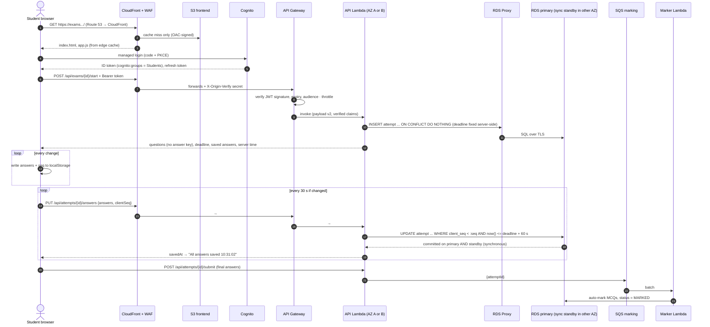
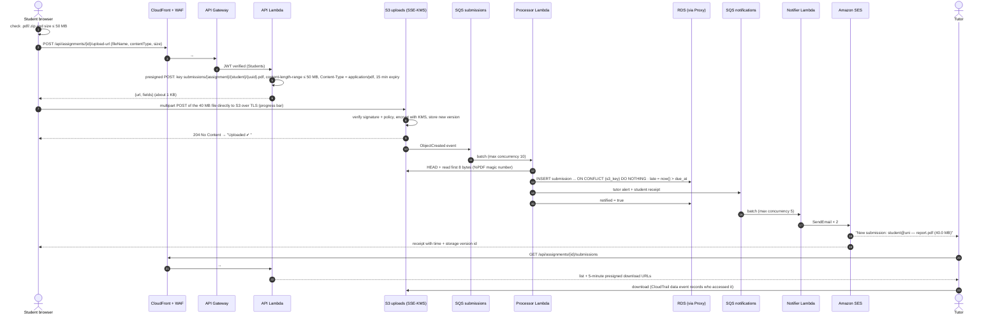

# Request walkthroughs

Both flows are implemented in the code and covered by the integration test
[`backend/tests/test_integration.py`](../backend/tests/test_integration.py).

---

## Walkthrough 1: a student opens an exam and answers autosave

Evidence: lab simulation [cal-01](../evidence/cal-01-walkthrough1-exam-autosave.png) (HTTP 200), the same flow with AZ-A down
[cal-03](../evidence/cal-03-az-a-outage.png) (served by AZ-B), and on AWS: autosave confirmed [aws-02](../evidence/aws-02-exam-autosave.png),
plus the API reaching the Multi-AZ database [aws-03](../evidence/aws-03-frontend-api-multi-az-db.png).

| # | Component | What happens | Why it matters |
|---|---|---|---|
| 1 | Route 53 → CloudFront | DNS resolves to the nearest edge; HTTPS (TLS 1.2+) terminates at CloudFront; WAF inspects the request. | The 3,000-student page-load burst is served from edge caches, not from the region. |
| 2 | Cognito | Managed login with authorization code + PKCE. The ID token carries `cognito:groups = Students`. The SPA refreshes the token 5 minutes before expiry. | Role-based sign-in; a 3-hour exam never logs the student out. |
| 3 | CloudFront → API Gateway | `/api/*` is never cached and is forwarded with the `X-Origin-Verify` secret header. | The API can't be called directly to bypass WAF. |
| 4 | API Gateway | The JWT authorizer validates signature, expiry, issuer and audience; stage throttling 1,500 rps / 3,000 burst. | Unauthenticated traffic never reaches Lambda. |
| 5 | API Lambda (private app subnet, either AZ) | `POST /exams/{id}/start` creates the attempt once (`ON CONFLICT DO NOTHING`), with `deadline = LEAST(now() + duration, closes_at)` computed **in the database**. Returns questions **without** `correct_option`, plus the server time. | Refreshing the page or changing the PC clock can't add time; the answer key never leaves the server. |
| 6 | Browser | Every keystroke or click writes `{answers, seq}` to `localStorage`. The timer uses the server-time offset. | If Wi-Fi drops, the tab closes or the DB fails over, nothing typed is lost; it is pushed on the next save or on resume. |
| 7 | Autosave every 30 s | `PUT /attempts/{id}/answers {answers, clientSeq}` → one `UPDATE … WHERE client_seq < :seq AND status='IN_PROGRESS' AND now() <= deadline + 60 s`. | Idempotent and ordered: a delayed retry can never overwrite newer answers; late saves after the deadline are rejected (409). |
| 8 | RDS Proxy → RDS Multi-AZ | The commit is replicated synchronously to the standby in the other AZ before it is acknowledged. | A saved answer survives the loss of an entire AZ (RPO 0 for that case). |
| 9 | Response | `savedAt` → "All answers saved 10:31:02". On error the banner says answers are kept on the device and retries. | The student always knows the state of their work. |
| 10 | Submit / timeout | Submit (or the timer reaching 0) sends final answers; the API queues `{attemptId}` on SQS; the marker Lambda auto-marks MCQs. If the browser is closed, the EventBridge sweeper auto-submits 1-3 min after the deadline. | Marking is asynchronous, so 3,000 submissions at the deadline don't hit the database at once. |

Observability: API Gateway access log (request id, user sub, latency), X-Ray trace API Gateway → Lambda, CloudWatch dashboard (requests, p99 latency, Lambda concurrency, DB CPU, queue depth).

---

## Walkthrough 2: a student uploads a 40 MB assignment and the tutor is notified

Evidence: lab simulation [cal-02](../evidence/cal-02-walkthrough2-upload-notify.png) (HTTP 202), and on AWS
[aws-04](../evidence/aws-04-upload-async-processing.png): the 41,943,049-byte object in S3, the processor's `RECEIVED` log, and the
"New submission" (tutor) and "Submission receipt" (student) emails sent by the notifier.

| # | Component | What happens | Why it matters |
|---|---|---|---|
| 1 | Browser | Rejects anything that is not `.pdf`/`.zip` or is over 50 MB before uploading. | Fast feedback; saves bandwidth. |
| 2 | API Lambda | Checks the role (Students) and that the assignment exists, then signs a **presigned POST** with `content-length-range 1..52,428,800`, an exact `Content-Type` and a server-chosen key. Only ~1 KB of JSON passes through the API. | API Gateway caps payloads at 10 MB and Lambda at 6 MB, so a 40 MB file *cannot* go through the API. Direct-to-S3 also keeps compute free during upload peaks. |
| 3 | S3 uploads bucket | The browser POSTs the file straight to S3 over TLS (CORS allows only the site origin). S3 enforces the signed policy (size, type, key, expiry), encrypts with the KMS key (bucket key) and stores a new version. | S3 itself rejects a 60 MB or renamed file; versioning means an upload can never destroy an earlier one. |
| 4 | S3 → SQS | `ObjectCreated` event on prefix `submissions/` → submissions queue (queue policy accepts only this bucket). | Decouples upload from processing; SQS retries 5× then dead-letters with an alarm. |
| 5 | Processor Lambda (VPC) | HEAD + 8-byte ranged GET: checks the `%PDF` / `PK\x03\x04` magic number matches the declared type. `INSERT … ON CONFLICT (s3_key) DO NOTHING`, sets the `late` flag against `due_at`. | Catches renamed or corrupt files; SQS is at-least-once, so the unique key makes redelivery harmless. |
| 6 | Notifications queue | The processor queues a tutor alert and a student receipt (with the S3 version id), then sets `notified = true`. | A crash before `notified` means SQS redelivers and the emails still go out (never lost). |
| 7 | Notifier Lambda → SES | Runs outside the VPC (no NAT dependency) with max concurrency 5 to stay under the SES send rate. | Email bursts (e.g. results release to 3,000 students) drain smoothly from the queue. |
| 8 | Tutor | Sees the submission and downloads it through a 5-minute presigned GET URL. A CloudTrail S3 data event records the access. | Files are never public; access is auditable for academic-integrity disputes. |
| 9 | Lifecycle | 30 d → Standard-IA, 180 d → Glacier Instant Retrieval, 365 d → Deep Archive, deleted after 1,830 days. | Meets the 5-year retention at the lowest storage cost. |
